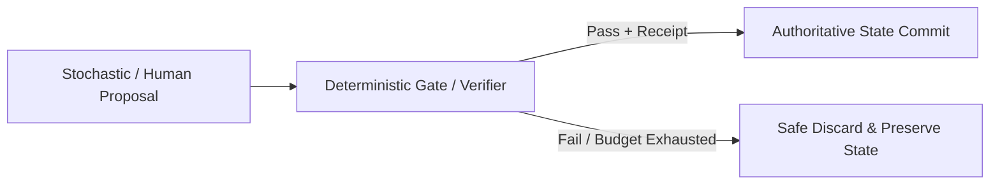

+++
slug = "separating-proposals-from-authority"
title = "Separating Proposals from Authority in Agent & Infrastructure Systems"
date = "2026-11-18"
author = "Kennedy Mosoti"
summary = "Lessons connecting an infrastructure code-review gate on Salt fleets to Metron's bounded runtime and Jacquard's executable Checks."
tags = ["metron", "jacquard", "agents", "reliability"]
+++

The hardest reliability problems rarely come from lack of code generation speed; they come from granting implicit authority to unverified proposals.

## Where the Pattern Started

In [Rejecting unnecessary AI-generated infrastructure code](/archive/deleting-generated-infrastructure-code), generated configuration code arrived faster than discovery of Salt's native primitives—and introduced recursive ownership mutations around symlink-sensitive paths. Peer review caught the blast radius before rollout, leading directly to [the eight-question gate](/archive/ai-generated-code-gate).

## Encoding the Boundary in Runtime Architecture

Instead of relying purely on human vigilance, three Moiric projects encode that boundary mechanically:

- **[Metron](/projects/metron):** Separates `ModelProvider` proposal streams from `metron-harness` admission budgets, `Landlock` + `seccomp-bpf` isolation, and Wasmtime AOT fuel limits recorded as `ResourceReceipt` rows.
- **[Jacquard](/projects/jacquard):** Ensures no language model's ranking or aesthetic opinion can approve a UI candidate on its own—only deterministic contrast, slop-lint, layout, and WASM budget Checks emit gating Receipts.
- **[Hephaestus](/projects/hephaestus):** Separates immutable source snapshots from orthogonal Observation Logs and hash-chained Decision Logs keyed by Jujutsu `ChangeId`.

Whether configuring a Linux fleet or orchestrating software agents, keeping proposal generation separate from authoritative commit makes failure inspectable and recovery cheap.
