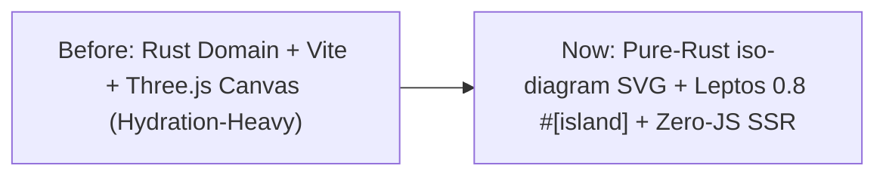

+++
slug = "replacing-threejs-with-pure-rust-cockpit"
title = "Replacing Three.js with a Pure-Rust 2.5D Leptos 0.8 Cockpit"
date = "2026-11-21"
author = "Kennedy Mosoti"
summary = "Moving kennedy.mosoti.dev from a Rust + Three.js hybrid to a unified Rust 1.100 stack using Jacquard's iso-diagram engine, Hallmark OKLCH tokens, and Leptos 0.8.23 Islands."
tags = ["rust", "leptos", "jacquard", "architecture"]
+++

When `kennedy.mosoti.dev` was first designed inside Jacquard's `products/installation`, Rust owned the domain rules and state transitions while TypeScript and Three.js owned pixels on a WebGPU/WebGL canvas. Maintaining two toolchains, two asset pipelines, a Vite service-worker build, and runtime shader budgets for what is fundamentally an architectural diagram was solving the wrong problem.

## The Shift: SVG Geometry + Leptos Islands

With **Jacquard** extracting reusable `products/cockpit` crates (`iso-diagram`, `telemetry-scene`, `cockpit-wiki`, and `cockpit-leptos`), the site collapses to **one language (Rust `1.100.0`)** and **one cascade (`Hallmark` CSS)**:

### What Changed

1. **Readable Without JavaScript:** Every project page, Wiki article, Blog post, and Biography record renders complete HTML and 2.5D SVG diagrams directly from Axum SSR. Visitors with JavaScript disabled, feed readers, and search indexers see the exact same technical documentation and schematics.
2. **Islands Where Interactivity Matters:** Only the interactive 2.5D orbit/zoom/project-bay stage hydrates as a Leptos `0.8.23` `#[island]`, keeping payload small and idle CPU at `0 Hz`.
3. **Warm Archival Paper & Night Materials:** The Hallmark token layer uses perceptual `OKLCH` colors via CSS `light-dark()`, `@layer`, `@scope`, and native `<dialog>` / `[popover]` primitives—eliminating ad-hoc color literals and bloated CSS frameworks.

### What Remains Honest

Replacing the renderer does not alter the site's [evidence discipline](/wiki/evidence-and-claims): production experience stays cleanly separated from independent Rust work, and every Moiric project states whether it is `Released Alpha`, `In Progress`, or `Architecture`.
