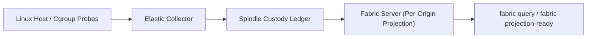

+++
slug = "fabrico11y"
name = "FabricO11y"
tagline = "Linux observability, Spindle custody ledger, and Arrow/Parquet telemetry"
status = "Released Alpha"
version = "v0.1.0-alpha.2 (v0.1.0-alpha.3 in progress)"
repo = "https://github.com/kmosoti/FabricO11y"
bay_id = "fabrico11y"
role = "Observability & Custody Telemetry"
summary = "Command-line Linux observability toolkit attributing CPU, memory, and disk pressure alongside job/agent receipts through Spindle custody logs and canonical projection queries."
claim_boundary = "Released Alpha (`v0.1.0-alpha.2`) ships Fedora x86_64 RPM packages and single-host/SSH-tunneled collection. Zero-UI `fabric-client` SDK, Debian `.deb` packaging, and loopback proxy modules (`v0.1.0-alpha.3`) are in progress. No production ownership of Arrow/Parquet pipelines is claimed."
highlights = [
  "Spindle durability layer separating local intake acknowledgement from canonical query visibility",
  "Cgroup v2 resource pressure and process memory blame attribution",
  "Explicit custody frontier and watermark-lag queries via `fabric projection-ready`",
  "Single-host or multi-origin forwarding over authenticated tunnels to Fabric Server"
]
+++

## Aim

**FabricO11y** investigates Linux host behavior and operational receipts from the inside out: how observations are captured under memory constraints, persisted through write-ahead logs and Spindle custody records, represented in Arrow and Parquet schemas, and queried separately over live buffers versus historical segments.

## Evidence Class & Status

- **Lifecycle Class:** `Released Alpha` (`v0.1.0-alpha.2` released with signed x86-64 Fedora RPM and Nix packaging; `v0.1.0-alpha.3` adding typed `fabric-client` Rust SDK, Debian `.deb` artifacts, and loopback-safe proxy configuration).
- **Evidence Boundary:** Independent systems engineering, kept strictly distinct from production Kafka/Logstash/Splunk troubleshooting records in [Biography](/biography) and [the FabricO11y archive note](/archive/fabrico11y).

## Architecture

## Mechanism

- **Custody vs. Visibility:** An observation accepted by a collector is not treated as queryable truth until Spindle advances its custody watermark and projects the segment cleanly.
- **Per-Origin Isolation:** Multiple independent Spindle origins can forward to a shared Fabric Server without blending origin custody ledgers or query frontiers.
- **Zero-UI Core:** Telemetry collection, custody verification, and query projections remain pure CLI and typed library primitives; visual cockpits consume typed telemetry projections without embedding collector state.
