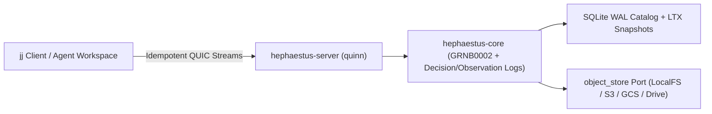

+++
slug = "hephaestus"
name = "Hephaestus"
tagline = "Authoritative Jujutsu (jj-lib) QUIC storage backend with Decision & Observation logs"
status = "Architecture"
version = "v0.1.0-alpha.1 (in progress)"
repo = "https://github.com/kmosoti/Hephaestus"
bay_id = "hephaestus"
role = "VCS Storage, Decisions & Observation Streams"
summary = "Idempotent Jujutsu (`jj-lib`) storage and replication backend over QUIC (`quinn`) with `GRNB0002` Zstd CAS bundles on `object_store`, SQLite WAL/LTX catalogs, hash-chained Decision Logs, and orthogonal Observation Logs."
claim_boundary = "Architecture and initial `v0.1.0-alpha.1` implementation in progress. Not a replacement for the `jj` CLI; provides an authoritative backend and typed evidence log model without live multi-node benchmark claims."
highlights = [
  "Idempotent `(repo_id, stream_kind, blake3_digest)` writes recorded atomically in SQLite WAL",
  "`GRNB0002` Zstd framing and BLAKE3 CAS layered over `object_store` (LocalFS, S3/R2, GCS, Drive)",
  "Append-only BLAKE3 hash-chained Decision Log keyed by `jj` `ChangeId` and `OpId`",
  "Orthogonal Observation Logs attaching test receipts and verifier verdicts without rewriting commit hashes"
]
+++

## Aim

Multi-agent and human software engineering produces two distinct streams of truth: immutable source snapshots and accumulating architectural decisions, test receipts, and verifier verdicts. Storing evidence inside commit trees mutates VCS hashes whenever a late verification runs. **Hephaestus** models an authoritative `jj-lib` storage backend over QUIC where the **Decision Log** and **Observation Logs** remain first-class, hash-chained, and strictly orthogonal to commit history.

## Evidence Class & Status

- **Lifecycle Class:** `Architecture` (active `v0.1.0-alpha.1` standalone extraction from early prototype `drive-store` and `node-vcs` components).
- **Evidence Boundary:** Independent architecture and implementation work. Throughput, durability, and multi-terabyte archival claims remain design targets backed by deterministic unit/simulation tests rather than live production SLA measurements.

## Architecture

## Mechanism

- **Crash-Safe Idempotency:** Every incoming bundle write logs its `(repo_id, stream_kind, blake3_digest)` key in SQLite WAL (`16 KiB` pages) before acknowledging the QUIC stream, making retries convergent.
- **Orthogonal Evidence:** Verifier receipts, benchmarks, and custody references bind cleanly to `(ChangeId, CommitId, OpId)` without triggering commit rewrites or rebases.
