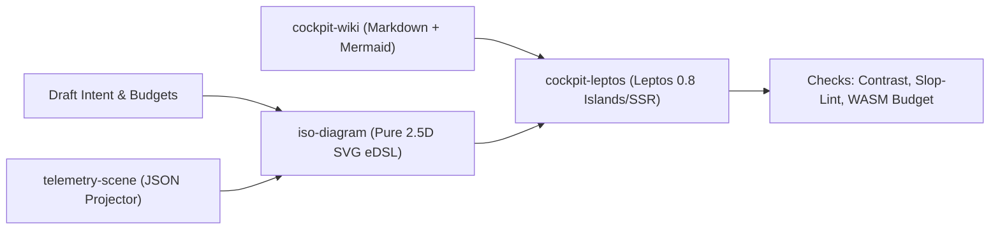

+++
slug = "jacquard"
name = "Jacquard"
tagline = "Evidence-gated UI factory, pure-Rust 2.5D iso-diagram engine, and Hallmark cockpit"
status = "In Progress"
version = "v0.1.0-alpha.1 (in progress)"
repo = "https://github.com/kmosoti/Jacquard"
bay_id = "jacquard"
role = "2.5D SVG Cockpit & Verification Factory"
summary = "UI factory and reusable cockpit toolkit weaving Hallmark-grade Leptos 0.8 Islands/SSR views and pure-Rust 2.5D isometric diagrams gated by executable Checks and Receipts."
claim_boundary = "In Progress toward `v0.1.0-alpha.1` public release. No model's judgment acts as a merge or release gate; acceptance requires passing deterministic layout, contrast, slop-lint, and WASM budget Checks."
highlights = [
  "Pure-Rust zero-dependency `iso-diagram` 2.5D hardware sprite, Manhattan router, and orbit SVG engine",
  "Hallmark x Leptos 0.8.23 Islands/SSR with CSS `@layer`, `@scope`, View Transitions, and Popover API",
  "Zero-JS SSR baseline paired with lightweight WASM island hydration",
  "`cockpit-wiki` Markdown + Mermaid engine and executable Check Receipts"
]
+++

## Aim

Just as a Jacquard loom lifts warp threads according to punched cards while inspection checks the finished cloth, **Jacquard** treats interface design as a verifiable pipeline: a `Draft` expresses design intent, a `Loom` weaves `Swatch` candidates, and only deterministic executable **Checks** emitting signed **Receipts** gate acceptance.

## Evidence Class & Status

- **Lifecycle Class:** `In Progress` (`v0.1.0-alpha.1` extracting reusable `products/cockpit` crates — `iso-diagram`, `telemetry-scene`, `cockpit-wiki`, and `cockpit-leptos` — into standalone Apache-2.0 crates).
- **Evidence Boundary:** Independent software engineering powering this site (`kennedy.mosoti.dev`) without any Three.js runtime or client-side WebGPU dependency.

## Architecture

## Mechanism

- **`iso-diagram`:** Projects 3D hardware blocks, racks, switches, pedestals, and orthogonal Manhattan conduits to SVG with configurable yaw/pitch orbit and 2D schematic fallback—requiring zero WebGL shaders or JavaScript engines.
- **Hallmark Cascade:** Uses semantic OKLCH light/dark palettes (`Atelier-Draft` paper daylight and `Oxide-Monolith` night), `light-dark()`, `tabular-nums`, and `0 Hz` settled idle state.
