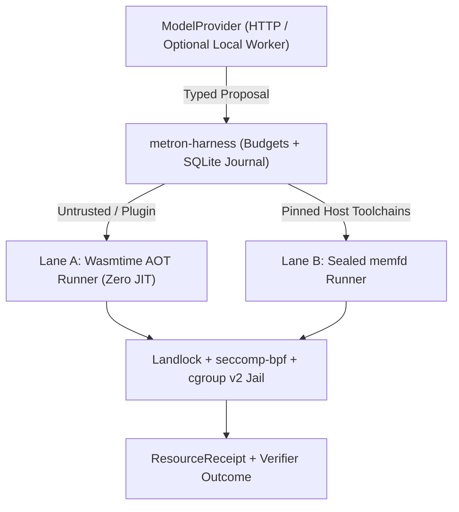

+++
slug = "metron"
name = "Metron"
tagline = "Bounded Rust agent runtime with deterministic authority and kernel/WASM sandboxing"
status = "In Progress"
version = "v0.1.0-alpha.1 (in progress)"
repo = "https://github.com/kmosoti/Metron"
bay_id = "metron"
role = "Bounded Computation & Sandbox"
summary = "Rust-native agent and execution harness separating stochastic model proposals from deterministic authority, SQLite ResourceReceipt journals, and two-lane zero-bwrap Wasmtime AOT + Landlock/seccomp isolation."
claim_boundary = "In Progress toward `v0.1.0-alpha.1`. Zero public release tags exist yet; useful model-written coding and complete resource gates remain open acceptance criteria tracked in the repository. No production agent-runtime deployment is claimed."
highlights = [
  "Stochastic generators propose actions; deterministic harness owns authority, budgets, and commit",
  "Durable SQLite journal recording ResourceReceipt fuel, memory, and execution limits",
  "Two-lane zero-bubblewrap sandbox: Wasmtime AOT (`memfd` sealed `.cwasm`) + Landlock/seccomp-bpf",
  "Pluggable `ModelProvider` boundary and `rmcp` MCP tool mediation"
]
+++

## Aim

Language models emit probabilistic proposals; treating a stochastic output as direct execution authority turns every sampling error into an uncontrolled side effect. **Metron** enforces a clean split: `metron-agent` and `ModelProvider` backends generate typed proposals, while `metron-harness` owns capability admission, resource budgets, sandboxed execution, verification, and commit/discard state in a durable SQLite journal.

## Evidence Class & Status

- **Lifecycle Class:** `In Progress` (`v0.1.0-alpha.1` architecture and sandbox transition underway).
- **Evidence Boundary:** Independent engineering and reliability research. See also [the Metron archive note](/archive/metron) and [the AI-generated code gate](/archive/ai-generated-code-gate). No production usage or completed benchmark suite is claimed.

## Architecture

## Mechanism

- **Zero-`bwrap` Two-Lane Sandbox:** Replaces `CLONE_NEWUSER` / `bubblewrap` wrappers with explicit kernel boundaries (`PR_SET_NO_NEW_PRIVS`, `Landlock` filesystem/TCP restrictions, pure-Rust `seccompiler` BPF syscall filtering, and `systemd-run --user --collect` cgroup caps).
- **AOT Isolation:** Untrusted `wasm32-wasip2` components compile out-of-process to `.cwasm` artifacts sealed with cryptographic integrity checks before running inside a Cranelift-free runtime with deterministic fuel and memory limits.
