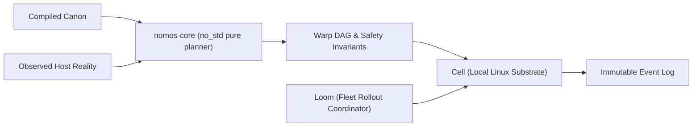

+++
slug = "nomos"
name = "Nomos"
tagline = "Deterministic Linux host convergence and fleet reconciliation"
status = "Released Alpha"
version = "v0.1.0-alpha.2 (v0.2.0-alpha.1 in progress)"
repo = "https://github.com/kmosoti/Nomos"
bay_id = "nomos"
role = "Control Plane & Host State Convergence"
summary = "Masterless Cell and fleet Loom controller that observe actual host state, measure Variance against a compiled Canon, plan valid dependency-ordered Warp actions, execute natively on Linux, and verify observed postconditions."
claim_boundary = "Released Alpha covers the single-host Debian 12/13 Cell (`v0.1.0-alpha.2`) managing files, directories, systemd units, sysctl parameters, accounts, and packages. Fleet Loom control, age+vTPM2 cipher adapters, WireGuard/QUIC transport, and GCP adapters (`v0.2.0-alpha.1`) are in progress and not claimed as production-proven."
highlights = [
  "Pure #![no_std] deterministic core bounded by PURITY.toml",
  "Hexagonal architecture enforced by cargo xtask check-layers and trust-boundary trailers",
  "Postcondition verification: exit code zero is never accepted without re-observing host reality",
  "Immutable append-only Event Log capturing every Canon comparison and transition"
]
+++

## Aim

Most configuration scripts execute commands against hosts and treat exit code zero as convergence. **Nomos** starts from the opposite premise: declare desired host state as a **Canon**, observe actual machine reality, compute the **Variance**, derive an explicit dependency-ordered **Warp** action graph under safety invariants (`N1–N12`), apply changes through native Linux interfaces (**Substrate**), and re-observe the machine until the intended postcondition is recorded in an immutable Event Log.

## Evidence Class & Status

- **Lifecycle Class:** `Released Alpha` (`v0.1.0-alpha.2` Cell on Debian 12 and 13; `v0.2.0-alpha.1` fleet Loom, WireGuard/QUIC, `age` + vTPM 2.0, and cloud adapters in active development).
- **Evidence Boundary:** Independent open-source engineering. Zero production deployment claims are made for `Nomos`; host convergence properties are verified against Debian container suites, layer-purity gates, and semantic mutation tests in the repository.

## Architecture

## Mechanism

- **Cell:** Runs autonomously on each managed Linux host, remaining functional even when disconnected from fleet coordination. Running `Enforce` twice converges to a no-op on the second pass because observed reality already matches the Canon.
- **Loom & Mesh *(In Progress for `v0.2.0-alpha.1`)*:** Coordinates staged rollouts across target machines while enforcing disruption budgets, generation fencing, and zero-alloc Sans-I/O IPv6 WireGuard/QUIC transport.
- **Verification Discipline:** Repository `xtask` gates separate specification commits (`Trust-Boundary: specification`), verifier/test harness commits (`Trust-Boundary: verifier`), and adapter implementations.
