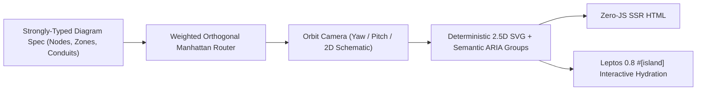

+++
slug = "cockpit-25d-without-threejs"
title = "Pure-Rust 2.5D Isometric Diagrams Without Three.js"
category = "Graphics"
updated = "2026-11-21"
summary = "Replacing a WebGPU/Three.js TypeScript pipeline with Jacquard's deterministic Rust iso-diagram SVG engine and Leptos 0.8 Islands/SSR."
tags = ["jacquard", "leptos", "svg", "wasm"]
+++

The previous incarnation of `kennedy.mosoti.dev` shipped a TypeScript + Three.js rendering pipeline alongside Rust/Leptos UI state. While visually expressive, embedding a multi-hundred-kilobyte JS/WebGL engine created unnecessary friction for zero-JS readers, accessibility audits, deterministic layout verification, and single-toolchain builds.

## How `iso-diagram` Replaces Three.js

1. **Zero-JS SSR First:** Because the entire 2.5D diagram renders as pure semantic SVG on the server, search engines, screen readers, RSS readers, and curl/text browsers receive complete system topology with zero client JavaScript execution.
2. **Progressive `#[island]` Hydration:** Only the interactive 2.5D cockpit viewport, orbit/zoom controls, and inspector selection hydrate via `wasm32-unknown-unknown`, keeping Markdown Wiki/Blog/Biography pages static and instant.
3. **Deterministic Layout & Contrast Verification:** SVG coordinates, callouts, contrast tokens (`Atelier-Draft` paper daylight and `Oxide-Monolith` night), and WASM byte budgets are verified directly in `cargo test`.
