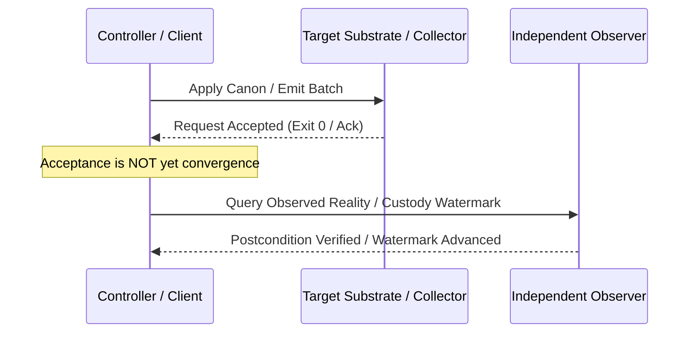

+++
slug = "deterministic-reconciliation"
title = "Observing Reality vs. Request Acceptance"
category = "Reliability"
updated = "2026-11-21"
summary = "Why exit code zero and HTTP 202 acceptance are rumors, linking production repave debugging with Nomos Canon reconciliation and FabricO11y custody frontiers."
tags = ["reconciliation", "observability", "nomos", "fabrico11y"]
+++

A recurring trap in platform automation is confusing *request acceptance* with *converged system state*. Whether a configuration runner returns exit code zero, an API returns `202 Accepted`, or a telemetry pipeline accepts a log packet, the only authoritative answer comes from observing an independent downstream signal.

## From Production Debugging to Systems Design

In [A repave process reported as hung](/archive/repave-observer-not-waiting), a supervising Python process appeared blocked while the downstream host rebuild API had already finished. The deadlock lived in an unconsumed pipe buffer between supervisor and child process—two observers of the same lifecycle telling contradictory stories.

## How the Principle Appears Across Moiric

- **In [Nomos](/projects/nomos):** `Trace` and `Enforce` verify postconditions by re-reading actual Linux kernel/filesystem/systemd state after applying a `Warp` action plan.
- **In [FabricO11y](/projects/fabrico11y):** `fabric projection-ready` explicitly tracks whether accepted Spindle segments have advanced through the canonical projection watermark.
- **In [Hephaestus](/projects/hephaestus):** QUIC stream acknowledgements wait until the SQLite WAL idempotency catalog durably commits the write tuple.
