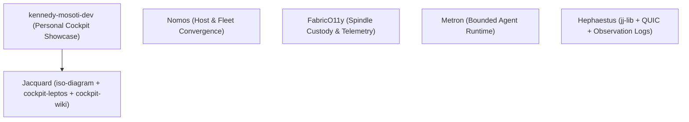

+++
slug = "moiric-architecture"
title = "The Moiric Ecosystem: Acyclic Systems Decomposition"
category = "Architecture"
updated = "2026-11-21"
summary = "How Nomos, FabricO11y, Metron, Jacquard, and Hephaestus decompose control, custody observability, sandboxed execution, UI verification, and VCS storage without cyclic dependencies."
tags = ["architecture", "rust", "moiric"]
+++

The **Moiric** architecture separates five operational concerns into independent, Apache-2.0 Rust `1.100.0` repositories so each layer can be tested, reasoned about, and released on its own schedule.

## Repository Boundaries

| System | Responsibility | Status |
| --- | --- | --- |
| [Nomos](/projects/nomos) | Desired-state Canon, Variance computation, Warp action DAG, and native Linux reconciliation | `Released Alpha` (`v0.1.0-alpha.2`) |
| [FabricO11y](/projects/fabrico11y) | Cgroup telemetry collection, Spindle custody ledger, and per-origin query projections | `Released Alpha` (`v0.1.0-alpha.2`) |
| [Metron](/projects/metron) | Bounded agent runtime, SQLite `ResourceReceipt` journal, and zero-`bwrap` Wasmtime/Landlock sandbox | `In Progress` (`v0.1.0-alpha.1`) |
| [Jacquard](/projects/jacquard) | Evidence-gated UI factory, pure-Rust `iso-diagram` 2.5D engine, and Hallmark × Leptos `0.8` cockpit | `In Progress` (`v0.1.0-alpha.1`) |
| [Hephaestus](/projects/hephaestus) | Authoritative `jj-lib` QUIC backend, `GRNB0002` CAS, Decision Log, and orthogonal Observation Logs | `Architecture` (`v0.1.0-alpha.1`) |

## Acyclic Dependency Topology

Each platform repository avoids hardcoding personal cluster topology, private IPv6 prefixes, or credentials. Thin composition lives outside the public crates, preserving clean open-source boundaries across every boundary gate.
